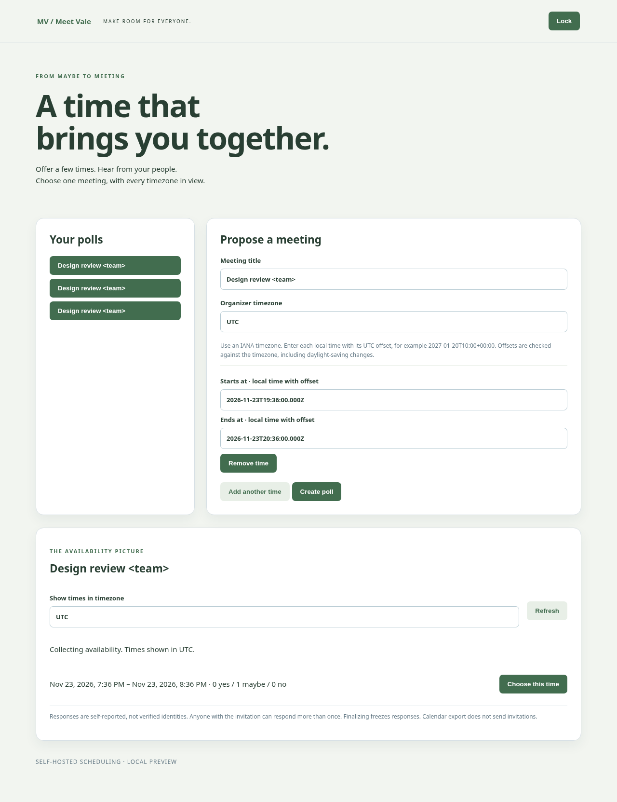

# Meet Vale

An open-source alternative for Doodle's group scheduling workflow, in preparation.

Implemented locally: immutable proposed slots, guest yes/maybe/no responses, private participant update credentials, aggregate counts, one final choice and UTC iCalendar export. Local English owner/guest browser preview included; no hosted demo or public release yet.



```sh
python3 -m venv .venv
. .venv/bin/activate
pip install -r requirements.txt
python -m unittest discover -s tests -v
```

Use Python 3.12 on Linux with system timezone data. The domain core uses the standard library; the HTTP service uses Flask. Proposed times require explicit offsets matching an IANA timezone. Nonexistent daylight-saving times are rejected; repeated local times are disambiguated by their offset. Slots must begin within 366 days and last 5 minutes to 12 hours.

Limits: 200 polls, 20 slots per poll, 100 participant records per poll. The invite secret grants poll viewing and participation; each participant gets a separate secret for updating only their own response. Secrets are hashed at rest. Display names are not verified identities, and people holding the invite can create multiple responses. Counts describe records, not verified unique people. Participant names are not exposed in the shared aggregate view.

Finalization freezes responses and selects one future slot; calendar exports use stable event IDs, UTC times, escaped text and UTF-8 line folding. Calendar import into actual calendar clients remains unverified. No email, calendar connection, notifications, recurring meetings, file attachments or Doodle feature parity is promised.

The included HTTP service authenticates owner operations and separates invite and participant credentials. [Run the local API](docs/API.md). Twenty domain/HTTP tests pass. The next steps are six interface languages, actual calendar-client import and persistent deployment/recovery acceptance.

[Scope and primary references](docs/SCOPE.md) · [MIT license](LICENSE)

## Try the browser workflow

Follow [local setup](docs/API.md), then open http://127.0.0.1:8102. Unlock with the owner key, propose times and save the invitation link. Open it in another tab to respond. Save the returned private update link to edit that response later. In the owner view, refresh counts and choose one final time; guests can then download the calendar file.

The current time-entry form uses explicit ISO local times and UTC offsets, checked against the organizer timezone. Guests can change the display timezone without losing unsubmitted answers. Secrets are held in memory; link fragments are removed after loading. Keep the original invitation/update link to reopen after refresh. Localhost links work only on the same computer.

Browser acceptance uses Node.js, Playwright and Chromium against a disposable server/database with `MEET_OWNER_KEY=meet-browser-test-key-000000000000000`: run `node scripts/browser.cjs`. Override `MEET_URL`, `MEET_TEST_KEY` or `CHROMIUM` as needed. It verifies creation, literal titles, timezone display, guest submission/private updates, counts, finalization, UTC calendar bytes and 390px layout. Actual calendar-app import remains unverified.
